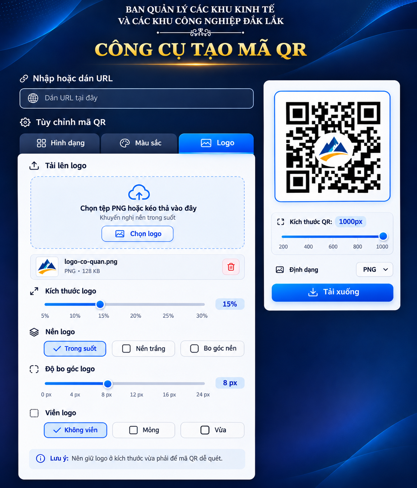

# CÔNG CỤ TẠO MÃ QR — V1.0

**Ban Quản lý các khu kinh tế và các khu công nghiệp Đắk Lắk**

Công cụ web tĩnh tạo mã QR từ **đường link URL** (website, liên kết đến tệp PDF, hình ảnh, Google Drive...), có xem trước trực tiếp, thiết kế các điểm QR/mắt QR, chỉnh màu, tải logo PNG, xuất PNG hoặc SVG. Phù hợp phục vụ hội nghị, tài liệu, giấy mời và các công việc văn phòng.



## 1. Chức năng đã triển khai

- Dán URL hợp lệ dạng `https://...` hoặc `http://...`, cập nhật mã QR sau khi chỉnh.
- **Ba tab độc lập**: `Hình dạng`, `Màu sắc`, `Logo`; chỉ hiển thị nội dung của tab được chọn.
- **Hình dạng**: sáu kiểu điểm dữ liệu; năm kiểu mắt ngoài, sáu kiểu mắt trong; điều chỉnh bo góc; bốn mức sửa lỗi L/M/Q/H; ba mức **độ đầy điểm chấm** Thưa/Trung bình/Cao.
- **Màu sắc**: chọn màu điểm QR, màu nền, mã màu HEX hoặc nền trong suốt.
- **Logo**: chọn/kéo thả ảnh PNG (tối đa 2 MB, tối đa 4096 × 4096 px), xem tên, xóa, chỉnh kích thước 5–22%, nền logo (trong suốt/trắng/trắng bo góc), bo góc và độ dày viền. Khi có logo, sử dụng sửa lỗi H.
- Xem trước mã QR theo thời gian thực, chọn kích thước xuất **200–2000 px**, tải PNG hoặc SVG, sao chép PNG vào bộ nhớ tạm nếu trình duyệt cho phép.
- Giao diện desktop và điện thoại. Không đăng nhập, không có cơ sở dữ liệu và không lưu lịch sử URL/logo.

**Giới hạn kỹ thuật cần biết:** Việc chọn Thưa/Trung bình/Cao chỉ thay đổi **độ đầy/chừa khoảng cách của các mô-đun** trên ảnh hiển thị; không thay đổi số lượng mô-đun đã mã hóa, không thay đổi mật độ dữ liệu hoặc cấu trúc QR chuẩn. Kiểu mắt quá cách điệu hoặc logo quá lớn có thể giảm khả năng quét. Luôn thử quét bằng điện thoại trước khi in.

## 2. Cấu trúc thư mục

```text
cong-cu-tao-ma-qr/
├── index.html                    Trang ứng dụng
├── src/
│   ├── styles.css                Giao diện, responsive
│   ├── app.js                     Chức năng tab, URL, logo, xuất file
│   └── qr-renderer.js             Vẽ SVG từ ma trận QR
├── assets/favicon.svg            Biểu tượng trang
├── vendor/                       Đặt thư viện QR để tự lưu trữ (không bắt buộc)
├── scripts/build.mjs             Tạo thư mục dist/ để triển khai
├── tests/
│   ├── renderer.test.mjs         Kiểm thử Node (không cần package)
│   └── browser_smoke.py          Kiểm thử có thể chạy tại máy phát triển
├── docs/                         Hình ảnh phác họa, tài liệu tham khảo
├── _headers                      HTTP security headers cho Cloudflare Pages
├── robots.txt                    Khuyến nghị công cụ tìm kiếm không lập chỉ mục
├── package.json                  Scripts build/test (không có package phụ thuộc)
├── LICENSE-THIRD-PARTY.md        Thành phần mã nguồn mở
└── HUONG_DAN_TRIEN_KHAI.md       Triển khai GitHub + Cloudflare Pages
```

## 3. Thư viện QR

Để tạo ma trận QR chuẩn, ứng dụng dùng thư viện mã nguồn mở **qrcode-generator v1.4.4 (MIT)**, theo thứ tự:

1. Tệp tự lưu trữ: `vendor/qrcode.min.js` (nếu có).
2. Cloudflare cdnjs (truy cập qua Internet).
3. jsDelivr (dự phòng).

**Điều này nghĩa là ứng dụng mặc định cần kết nối mạng để lấy thư viện QR nếu chưa có tệp `vendor/qrcode.min.js`.** Mã QR sau đó được xử lý ngay trong trình duyệt. Khi người dùng dán URL hoặc chọn PNG, ứng dụng **không gửi nội dung URL hoặc tệp PNG đến máy chủ**, ngoại trừ các truy vấn duyệt/tải đường link đích mà chính người dùng thực hiện bên ngoài ứng dụng. Bản thân CDN vẫn nhận yêu cầu tải script (thông tin HTTP thông thường).

Muốn không phụ thuộc CDN, lấy bản phân phối từ trang thư viện:

`https://cdnjs.cloudflare.com/ajax/libs/qrcode-generator/1.4.4/qrcode.min.js`

Lưu thành `vendor/qrcode.min.js` trong kho GitHub, giữ nguyên bản quyền MIT. Tạo lại bản triển khai; sau đó mã nguồn thư viện được phục vụ trực tiếp từ Cloudflare Pages của ứng dụng. Đây là **tùy chọn khuyến nghị** nếu dùng thường xuyên trong cơ quan.

## 4. Chạy thử và kiểm tra

Cần Node.js phiên bản 18 trở lên (chỉ để chạy script quản trị/test, không cần để người dùng sử dụng website).

```bash
npm test
npm run check
npm run build
```

Sau khi build sẽ có thư mục `dist/` chứa toàn bộ tệp website. Có thể thử cục bộ bằng cách sử dụng máy chủ tĩnh, ví dụ:

```bash
python -m http.server 8080
```

Sau đó mở `http://localhost:8080/` bằng Chrome hoặc Edge. Khi thử theo cách này mà chưa đặt `vendor/qrcode.min.js`, máy tính phải truy cập được CDN. **Không mở trực tiếp `index.html` qua `file://`** do trình duyệt có thể hạn chế module JavaScript.

Để chạy thử ứng dụng sau build bằng Python:

```bash
cd dist
python -m http.server 8080
```

## 5. Đưa lên GitHub và Cloudflare Pages

Đọc **[HUONG_DAN_TRIEN_KHAI.md](HUONG_DAN_TRIEN_KHAI.md)**. Cấu hình chính:

| Thiết lập Cloudflare Pages | Giá trị |
|---|---|
| Dự án | Pages + kết nối kho GitHub |
| Framework preset | None / Không dùng framework |
| Production branch | `main` |
| Build command | `npm run build` |
| Build output directory | `dist` |
| Root directory | `/` (mặc định) |

Mỗi lần đẩy thay đổi vào nhánh `main`, Cloudflare Pages sẽ xây dựng lại bản website. Không cần Cloudflare Workers, cơ sở dữ liệu, Google Sheet hay tên miền riêng.

## 6. Lưu ý khi dùng trong cơ quan

- **Ứng dụng mở**: đường dẫn website có thể được bất kỳ người nào truy cập nếu biết URL. `robots.txt` chỉ hạn chế lập chỉ mục, không phải biện pháp bảo mật.
- Nếu mã QR trỏ đến PDF/ảnh trong Google Drive, người quét phải có quyền xem theo cấu hình chia sẻ tệp đó. Chỉ cần dán đường link, không tải tài liệu lên công cụ.
- Mã QR tĩnh không có thời hạn sử dụng do phần mềm đặt ra. Nếu tệp đích bị xóa, bị đổi link hoặc mất quyền truy cập, QR sẽ không mở được.
- Không dùng công cụ này như giải pháp lưu trữ/bảo mật tài liệu mật hoặc nhạy cảm.
- Để QR quét tốt, nên dùng **mã QR màu đậm, nền sáng, độ đầy Cao, kiểu mắt vuông**, tránh logo quá lớn.
- Đường link có ký tự Unicode được chuẩn hóa sang URL mã hóa phần trăm trước khi tạo QR, giúp tương thích thư viện mã hóa byte.

## 7. Kiểm thử đã thực hiện khi bàn giao

- `npm test`: 12 ca kiểm thử JavaScript thành công.
- `npm run check`: tệp JavaScript không có lỗi cú pháp.
- `npm run build`: tạo `dist/index.html` thành công.
- Thử nghiệm Chromium với **ma trận QR được tạo từ thư viện Python**: tải PNG không logo và có logo, cả hai được OpenCV giải mã đúng URL thử nghiệm; xuất SVG chứa logo PNG cũng thành công; chuyển tab chỉ hiện đúng nhóm chức năng.

**Chưa xác minh trực tiếp** tốc độ hoặc khả năng tải thư viện QR qua CDN từ môi trường Cloudflare Pages thực tế, vì môi trường xây dựng hiện tại hạn chế truy cập mạng ngoài. Cần kiểm tra lại URL đầu tiên trên website đã triển khai theo checklist kèm theo.
